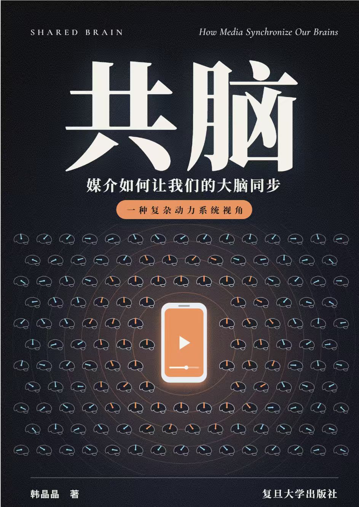

{.profile}

Hello, my name is Jingjing Han. I am an Associate Professor of Communication at [the School of Journalism, Fudan University](https://xwxy.fudan.edu.cn/NewsEn/), and an affiliated researcher at the Shanghai Key Laboratory of Data Science and the Institute for Global Communications and Integrated Media at Fudan University.

My research focuses on the dynamics of cognitive and emotional processing during human-human and human-machine/media communication, using the complex dynamic systems framework as the primary approach. My work has been published in *Journal of Communication*, *Communication Research*, *Communication Monographs*, *Media Psychology*, *Journal of Advertising*, *Communication Methods and Measures*, and *Topics in Cognitive Science*, and reported by media outlets such as *The Wall Street Journal*.

I currently serve as Associate Editor of [*Cognitive Science*](https://onlinelibrary.wiley.com/journal/15516709/), on the Editorial Board of *Journal of Communication*, and as Vice Chair (2025–2027) and incoming Chair (2027–2029) of [the Information Systems Division of ICA](https://infosysica.org/).

I obtained my Ph.D. in Media Arts and Sciences, with a minor in Cognitive Science, from Indiana University Bloomington. Before returning to China, I was a Lecturer in the Department of Communication at Santa Clara University.

Temporary cover designed by the author. The official cover is coming soon.

New book · Forthcoming

Shared Brain: How Media Synchronize Our Brains

共脑：媒介如何让我们的大脑同步

Fudan University Press · In press · Written in Chinese

Synchrony is a universal and fascinating phenomenon in nature. From fireflies flashing simultaneously, crickets chirping together, and flocks of birds flying in coordinated patterns, to pacemaker cells in the heart oscillating rhythmically and neurons firing together, synchrony is everywhere. Human society, too, is filled with synchronized behavior at multiple levels: people dancing together to music, audiences applauding in unison at the end of a performance, and conversational partners unconsciously adopting similar body postures. These seemingly unrelated phenomena all illustrate a fundamental principle of nature: the beautiful order that emerges from interactions among individuals in complex systems.

Media technologies, too, have the power to synchronize our emotions and cognition. How can a live television broadcast make viewers separated by vast distances share the same emotions, as if breathing and feeling as one? Why do strangers sitting side by side in a movie theater, without talking to one another, laugh and cry at the very same moments? How can a news report lead the public to develop similar understandings of the same social event, yet at other times provoke sharply opposing views? And why can a short video on social media so quickly resonate with audiences and spark public discussion? These questions seem so self-evident that we rarely stop to reflect on them. Yet they lie at the very heart of what this book seeks to investigate.

By focusing on interpersonal physiological synchrony, this book explores how media synchronize our brains and physiological responses. By uncovering the neural and physiological mechanisms through which media give rise to synchrony among individuals, it may offer a new perspective on understanding how media foster collective resonance and contribute to the formation of social consensus.

