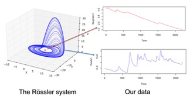
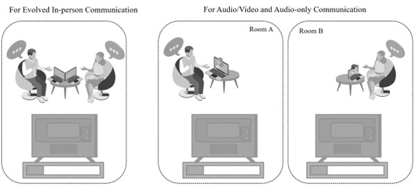

Latest update: 11/15/2026

My research is rooted in communication science and cognitive science. My research focuses on system-level dynamics in cognition, emotion, and behavior in human-human and human-media/machine communication, using the complex dynamic systems framework and computational and nonlinear dynamical tools.
The goal of my research program is to employ dynamic systems theory and complex systems analyses to accurately model, explain, and predict dynamic communication behaviors.

Dynamic cognitive and emotional processingPsychophysiological synchronyNonlinear dynamical systemsCommunication technology

### A Complex Dynamic Systems Framework to Communication Research

Communication is inherently complex and dynamic, involving numerous continuously changing variables. The interactions among these variables give rise to patterns that can differ qualitatively from one another. This perspective shapes my theoretical approach to communication research: complex dynamical systems theory (CDST). I view human communication as a dynamic system in which components evolve over time and interact in nonlinear ways. As such, the system cannot be reduced to isolated parts; or in other words, the whole is not the sum of its elements.

Together with my doctoral advisor Dr. Annie Lang, my conceptual work, published in *Media Psychology*, demonstrates how this complex dynamic systems approach can facilitate communication research by fundamentally changing the conceptualization of communication leading to new research questions, reinterpretation and reanalysis of existing data and development of novel approaches to research design, data collection and analysis. In the paper, we use concrete examples from communication literature to demonstrate that looking at averages across time and across individuals might prevent us from understanding the dynamics of human communication and why controlling for specific contexts fails to explain the role of context in the system. Specific steps are introduced that communication scholars could take with this novel theoretical perspective in order to understand how human communication systems evolve over time and over the life course. This paper also received a Top Paper Award at the annual meeting of the International Communication Association in 2018.

::: {.relevant}
**Relevant publications**

**Han, J.**, & Lang, A. (2020). It's a journey: From media effects to dynamic systems. *Media Psychology*, 23(3), 415–435. [PDF](publications/HanLang2019.pdf)

**Han, J.**, & Amon, M. (2021). A nonlinear dynamical systems approach to emotional attractor states during media viewing. *Proceedings of the Annual Meeting of the Cognitive Science Society*, 43, 2281–2287. [PDF](publications/HanAmon_CogSciProceeding21.pdf) [Video](https://youtu.be/sJt5OfNs8Lk)

Bailey, R., **Han, J.**, & Read, G. (2025). Dynamic systems and media psychology. In R. Bailey & G. L. Read (Eds.), *De Gruyter handbook of media psychology*. De Gruyter.

sMiao, G. Q., Weiss, M., Ni, Y., & **Han, J.** (2026). DIMS: A no-code dashboard linking multimodal dynamic signals to communication practices. *Communication Methods and Measures*. Online first publication.
:::

If you're interested in 'dynamics' or in the limitations of averaging data, I highly recommend you to read this book: [The End of Average](https://www.amazon.com/End-Average-Succeed-Values-Sameness/dp/0062358367)

### Shared Biological and Neurological Processes

Following the overarching CDST approach, this research line attempts to advance a paradigm shift from a single-brain approach to a multi-brain framework. For decades, researchers have investigated cognition, emotion, and behavior by isolating individuals from their natural environments. Most of what we know about mediated message processing comes from lab studies with individuals sitting in front of a large screen in a controlled setting. However, because worldly embedded social interaction is the essence of people's experience, it is important to consider these complex interactions when understanding communication, cognition, and behavior. The significance of this shift to a multi-brain framework can be likened to the history of human understanding of the solar system. Studying cognition at the individual level is akin to Ptolemy's egocentric view of the solar system. Only when Copernicus introduced the interactions between planets did we begin to truly understand the complexity of the solar system.

My research program first focused on a complex communication context, video co-viewing, where both interpersonal and mass communication co-exist and jointly influence one's information processing and behavior. I examined each type of communication involved in video co-viewing independently, i.e., human-media and human-human interactions, and then explored their combined effects.

Specifically, I examined how individuals' physiological process can be synchronized as a function of emotional content of videos. This human-media interaction piece was recognized as a Top Paper at ICA in 2021 and published in *Communication Monographs* (Han et al., 2022).

After that, I investigated how individuals process information from interpersonal conversations across a variety of mediated technologies. This analysis, published in *Journal of Communication* (Han et al., 2024), examined individuals' information processing patterns during conversations and how these patterns give rise to a shared information processing pattern, operationalized as interpersonal synchronization in psychophysiological responses, between the conversants.

Finally, by combining human-media and human-human interactions in a video co-viewing context, I have examined how system dynamics can be altered as a function of individual, media, and task differences, by analyzing multimodal, multi-timescale data across individuals. This line of research is also summarized in my book, *Shared Brain: How Media Synchronize Our Brains* (Fudan University Press, in press).

This series of studies suggests that interpersonal communication is such a powerful factor that it can alter the system dynamics both physiologically and behaviorally; more importantly, its existence diminishes the media effect found in previous research where interpersonal communication was forbidden. Therefore, my research indicates that examining single timescales (for instance either behaviorally or physiologically) and focusing their effects on individuals might not be sufficient for a holistic understanding of the system. Instead, the system-level dynamics approach that focuses on system-level behaviors across multiple time scales, offers a new way of conceptualizing and operationalizing variables in each level, leading to novel and critical understanding of communication dynamics.

::: {.relevant}
**Relevant publications**

**Han, J.** (in press). *Shared brain: How media synchronize our brains*. Fudan University Press.

**Han, J.**, Cores-Sarria, L., & sZhou, H. (2024). In-person, video conference, or audio conference? Individual and dyadic information processing as a function of communication system. *Journal of Communication*, 74(2), 117–129. [PDF](publications/HanJOC2023.pdf)

**Han, J.**, Lang, A., & Amon, M. J. (2022). Can media synchronize our physiological responses? Skin conductance synchrony as a function of message valence, arousal, and emotional change rate. *Communication Monographs*, 89(1), 47–69. [PDF](publications/HanLangAmon_CommMonographs_2022.pdf) [Video](https://youtu.be/zjg6qYk91ps)

Aaron, N., **Han, J.**, Vrzakova, H., & Amon, M. J. (2026). Understanding collective human behavior in social media networks via the dynamical hypothesis. *Topics in Cognitive Science*, 18, e12702. [PDF](publications/NecaiseHan2023.pdf)
:::

### Mediated Message Processing

I have also applied the Limited Capacity Model of Motivated Mediated Message Processing (LC4MP; Lang, 2003, 2006, 2017) to investigate embodied cognition, emotional spillover effects, message order effects, and memory processes across various contexts including video viewing, advertising, health, and sports communication.

::: {.relevant}
**Relevant publications**

**Han, J.**, & Ni, Y. (in press). Cognitive and emotional processing involved in video co-viewing: A naturalistic comparison with solo viewers. *Communication Research*.

**Han, J.**, Ni, Y., Amon, M. J., Necaise, A., sHan, M., & Lee, M. (2025). Multimodal physiological responses predict advertisement effectiveness. *Journal of Advertising*, 54(5), 693–712.

\*Cores-Sarria, L., \***Han, J.**, Myrick, J., & Potter, R. (2023). The effects of "media tech neck": The impact of spinal flexion on cognitive and emotional processing of videos. *Communication Research*, 50(5), 584–609. [PDF](publications/CR2023.pdf) 
\* authors made equal contribution

Kim, M., Potter, R., & **Han, J.** (2023). Motivational system approach to understand ad processing following various game outcomes. *Sport Management Review*, 26(4), 517–539. [PDF](publications/LeePotterHan2022.pdf)
:::
